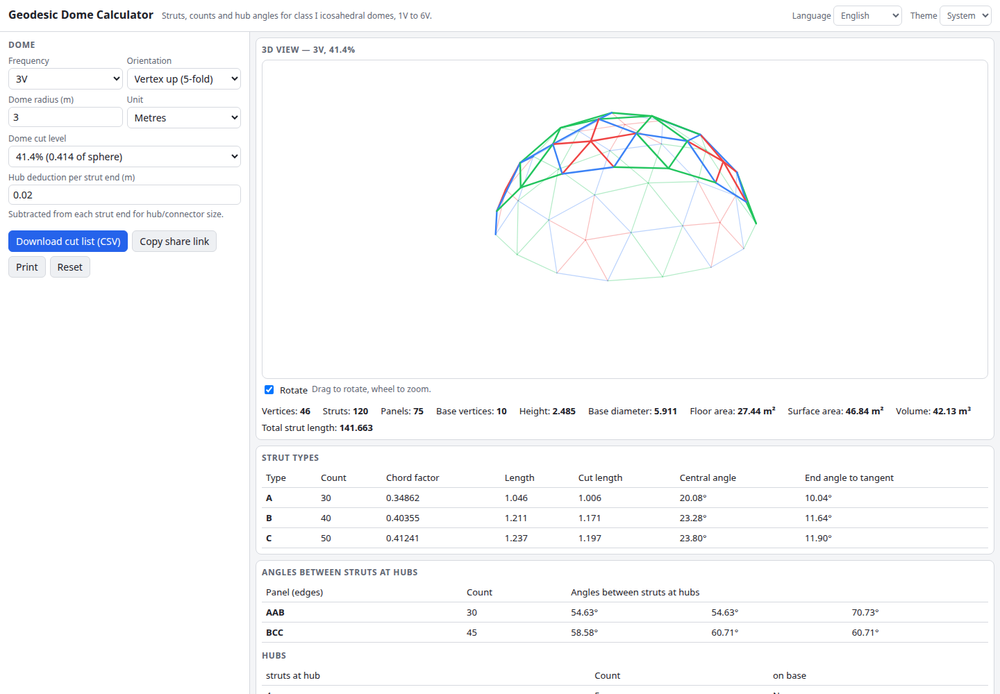

# Geodesic Dome Calculator

Plan a geodesic dome: pick an icosahedral frequency from 1V to 6V (class I), a radius and where to cut the sphere, and get the strut types, lengths, counts, hub angles and a cut list.

**Try it: https://hermes98761234.github.io/geodesic-dome-calculator/**

[](https://github.com/hermes98761234/geodesic-dome-calculator/actions/workflows/deploy.yml)



## Features

- Frequencies 1V to 6V, three icosahedron orientations (vertex, edge or face up)
- Dome fraction: cut at any vertex level, from a small cap to the full sphere, with height, base diameter, floor area, surface area and volume
- Strut types with chord factors, theoretical and cut lengths (hub deduction), central and tangent end angles
- Triangle panel types with the angles between struts at the hubs, and hub counts
- Interactive 3D view (drag to rotate), colour-coded by strut type
- Units: m, cm, ft, in (feet-inches output); cut list CSV download; print
- English and Ukrainian UI, light/dark/system theme, settings saved in the browser, shareable links
- Fully client-side: no backend, no tracking, your data never leaves the browser

## How it works

The icosahedron is subdivided on each face into f^2 triangles (class I method), every new vertex is projected onto the sphere, and strut lengths are the chords between vertices. Chord factors are multiplied by the radius; they match the textbook values (for example 2V: 0.54654 and 0.61803, 3V: 0.34862, 0.40355, 0.41241). Domes are cut by a horizontal plane at one of the distinct vertex heights so that the base is flat.

## Quick start

```sh
npm install
npm run dev      # development server
npm test         # unit tests (vitest)
npm run lint     # oxlint
npm run build    # type-check and production build into dist/
```

## License

MIT, see [LICENSE](LICENSE).
